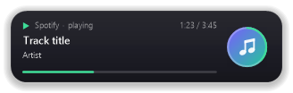
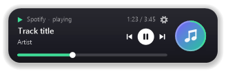
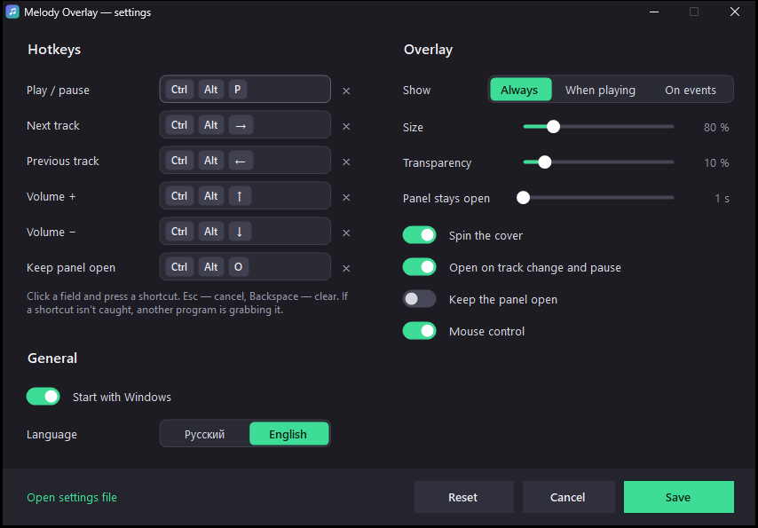

# Melody Overlay

**English** | [Русский](README_RU.md)

A small overlay for controlling your music on top of any window — no Alt+Tab.

A round bubble with the cover art of the current track sits at the edge of your screen. Click it, press a hotkey
or let the track change — and it smoothly opens into a panel with the title, artist, progress and buttons, then
folds back into the bubble a few seconds later.

  
  &nbsp;&nbsp;
  
  &nbsp;&nbsp;
  

Handy in games, full-screen apps, at work, on a second monitor — anywhere you don't want to switch
to your player or browser. Works with anything that shows up in the Windows media controls: Spotify, YouTube and
other sites in your browser, Apple Music, Yandex Music, Windows Media Player, VLC, AIMP, Telegram and more.
The overlay never steals focus from the active window and doesn't show up in Alt+Tab.

## Download

Grab `MelodyOverlay.exe` from [Releases](../../releases/latest) and run it — no installation needed.
The bubble appears in the top-right corner, the app icon — in the system tray.

- Requires Windows 10 (version 1809 or later) or Windows 11. Everything else is already part of Windows.
- No administrator rights needed.
- The exe isn't code-signed, so Windows may show "Windows protected your PC".
  Click "More info" → "Run anyway", or build the exe yourself from source (see below).
- English and Russian interface. The language follows Windows by default and can be switched in settings.

## The bubble

- **cover art** of the current track, a thin **progress ring** around it; the cover slowly spins while music plays
  and stops when paused (dimmed with a pause sign);
- **when to show** — always, only while music plays, or only on events (track change, pause, hotkeys):
  then the bubble appears together with the panel and fades away after it folds;
- **click** — open the panel, click again — fold it;
- **drag** — put the bubble anywhere, the spot is remembered;
- **right-click** — menu: expand, keep the panel open, put the bubble back, settings, exit.

On the open panel, hover with the mouse to reveal its buttons — the panel won't fold while the mouse is over it:

- **⏮ ⏯ ⏭** — previous track, play / pause, next track;
- **progress bar** — click or drag the handle to seek (if the player allows it);
- **gear** — open settings.

## Hotkeys

| Shortcut         | Action                              |
|------------------|-------------------------------------|
| Ctrl+Alt+P       | play / pause                        |
| Ctrl+Alt+→       | next track                          |
| Ctrl+Alt+←       | previous track                      |
| Ctrl+Alt+↑ / ↓   | system volume ±2 %                  |
| Ctrl+Alt+O       | keep the panel open / let it fold   |

Every hotkey opens the panel for a few seconds so you can see what happened. All shortcuts can be changed in settings.

## Settings

Double-click the tray icon, click the gear on the panel, or right-click the bubble → "Settings…".

  

- **Hotkeys** — click a field and press the shortcut you want. Esc cancels, Backspace or "×" disables it.
  If a shortcut is taken by another program or used twice, the field turns red.
- **Overlay** — when to show (always / when playing / on events), size, transparency of the folded bubble,
  how long the panel stays open, spinning cover.
  Changes are previewed live. "Mouse control" off makes the mouse pass right through the bubble.
  The bubble's spot is set by dragging it; "Put the bubble back" in the tray or bubble menu returns it to the corner.
- **General** — start with Windows, interface language (English / Русский).

Letters, digits and arrows need two modifiers (e.g. Ctrl+Alt) so that everyday shortcuts like Ctrl+C keep
working. F1–F24, the numpad, Pause and Scroll Lock can be used without modifiers.

Settings are stored in `MelodyOverlay.ini` next to the exe. You can edit it by hand too — changes are picked up
automatically.

## Full-screen games

- **Borderless / windowed** — the bubble is shown on top of the game.
- **Exclusive full screen** — Windows doesn't allow drawing over such games, so the bubble won't be visible,
  but **hotkeys still work**. To see the bubble, switch the game to borderless mode. In games that hide the
  cursor, use the hotkeys.

## Building from source

Run `build.bat` — it builds `MelodyOverlay.exe` with the C# compiler that ships with Windows
(.NET Framework 4.x). Nothing to install.

| File               | Contents                                                |
|--------------------|---------------------------------------------------------|
| `MelodyOverlay.cs` | bubble and panel, tray, hotkeys, media session handling |
| `SettingsForm.cs`  | settings window                                         |
| `app.manifest`     | DPI awareness and Windows 10/11 compatibility           |
| `icon.ico`         | app icon                                                |

## License

[MIT](LICENSE)
