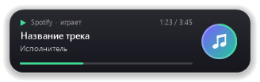
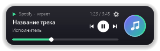
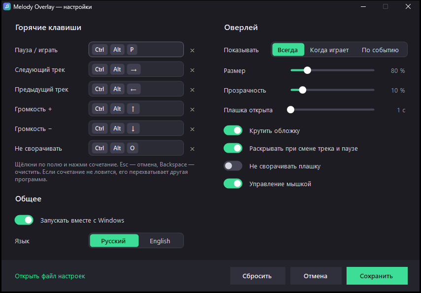

# Melody Overlay

[English](README.md) | **Русский**

Небольшой оверлей для управления музыкой поверх любых окон — без Alt+Tab.

У края экрана висит кружок с обложкой того, что сейчас играет. Щёлкни по нему, нажми горячую клавишу или просто
дождись смены трека — и он плавно раскроется в плашку с названием, исполнителем, прогрессом и кнопками, а через
несколько секунд свернётся обратно.

  
  &nbsp;&nbsp;
  
  &nbsp;&nbsp;
  

Удобно в играх, в полноэкранных программах, на работе, на втором мониторе — везде, где не хочется
переключаться в плеер или браузер. Работает со всем, что видно в системной панели мультимедиа Windows: Spotify,
Яндекс Музыка, YouTube / VK / Яндекс в браузере, Apple Music, медиаплеер Windows, VLC, AIMP, Telegram и т.д.
Оверлей не забирает фокус у активного окна и не попадает в Alt+Tab.

## Скачать

Возьми `MelodyOverlay.exe` на странице [Releases](../../releases/latest) и запусти — установка не нужна.
Кружок появится в правом верхнем углу, значок программы — в трее, возле часов.

- Нужна Windows 10 (версия 1809 или новее) или Windows 11. Всё остальное уже есть в системе.
- Права администратора не нужны.
- exe не подписан, поэтому Windows может показать «Система Windows защитила ваш компьютер».
  Нажми «Подробнее» → «Выполнить в любом случае». Или собери exe сам из исходников (см. ниже).
- Интерфейс на русском и английском. По умолчанию язык как в Windows, переключается в настройках.

## Кружок

- **обложка** текущего трека и тонкое **кольцо прогресса** по краю; пока играет музыка, обложка медленно крутится,
  на паузе останавливается и притемняется со значком паузы;
- **когда показывать** — всегда, только пока играет музыка или только по событию (смена трека, пауза, горячие
  клавиши): тогда кружок появляется вместе с плашкой и плавно исчезает, когда она свернётся;
- **щелчок** — раскрыть плашку, ещё щелчок — свернуть;
- **перетащить** — поставить кружок куда удобно, место запоминается;
- **правый щелчок** — меню: развернуть, не сворачивать плашку, вернуть кружок на место, настройки, выход.

На раскрытой плашке наведи мышку — появятся кнопки, и плашка не свернётся, пока мышь над ней:

- **⏮ ⏯ ⏭** — предыдущий трек, пауза / играть, следующий трек;
- **полоса прогресса** — щёлкни или протащи бегунок, чтобы перемотать (если плеер это позволяет);
- **шестерёнка** — открыть настройки.

## Горячие клавиши

| Клавиши          | Действие                               |
|------------------|----------------------------------------|
| Ctrl+Alt+P       | пауза / играть                         |
| Ctrl+Alt+→       | следующий трек                         |
| Ctrl+Alt+←       | предыдущий трек                        |
| Ctrl+Alt+↑ / ↓   | громкость системы ±2 %                 |
| Ctrl+Alt+O       | не сворачивать плашку / снова сворачивать |

Каждая горячая клавиша раскрывает плашку на несколько секунд — видно, что произошло.
Все сочетания можно поменять в настройках.

## Настройки

Двойной клик по значку в трее, шестерёнка на плашке или правый щелчок по кружку → «Настройки…».

  

- **Горячие клавиши** — щёлкни по полю и нажми нужное сочетание. Esc — отмена, Backspace или «×» — отключить.
  Если сочетание занято другой программой или повторяется, поле подсветится красным.
- **Оверлей** — когда показывать (всегда / когда играет / по событию), размер, прозрачность свёрнутого кружка,
  сколько плашка остаётся открытой, вращение обложки.
  Изменения сразу видны на экране. Если выключить «Управление мышкой», мышь будет проходить сквозь кружок.
  Место кружка задаётся перетаскиванием; «Вернуть кружок на место» в меню трея или кружка вернёт его в угол.
- **Общее** — автозапуск вместе с Windows и язык интерфейса (Русский / English).

Для букв, цифр и стрелок нужны два модификатора (например Ctrl+Alt), чтобы не сломать обычные
сочетания вроде Ctrl+C. F1–F24, цифровой блок, Pause и Scroll Lock можно назначать и без них.

Настройки хранятся в `MelodyOverlay.ini` рядом с exe — его можно править и вручную, изменения подхватываются сами.

## Полноэкранные игры

- **Без рамки / в окне** — кружок виден поверх игры.
- **Эксклюзивный полноэкранный режим** — Windows не даёт рисовать поверх такой игры, поэтому кружка
  видно не будет, но **горячие клавиши всё равно работают**. Чтобы видеть кружок, поставь в игре
  режим «Без рамки» (Borderless). В играх, где курсор спрятан, выручают горячие клавиши.

## Сборка из исходников

Запусти `build.bat` — он соберёт `MelodyOverlay.exe` компилятором C#, который уже есть в Windows
(.NET Framework 4.x). Ничего устанавливать не нужно.

| Файл               | Что внутри                                              |
|--------------------|---------------------------------------------------------|
| `MelodyOverlay.cs` | кружок и плашка, трей, горячие клавиши, работа с плеерами |
| `SettingsForm.cs`  | окно настроек                                           |
| `app.manifest`     | DPI и совместимость с Windows 10/11                     |
| `icon.ico`         | иконка                                                  |

## Лицензия

[MIT](LICENSE)
